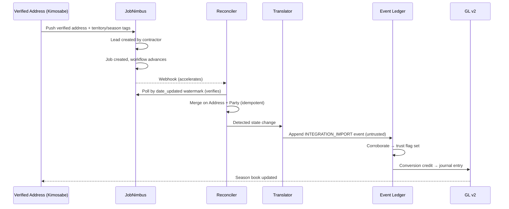
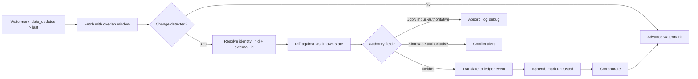
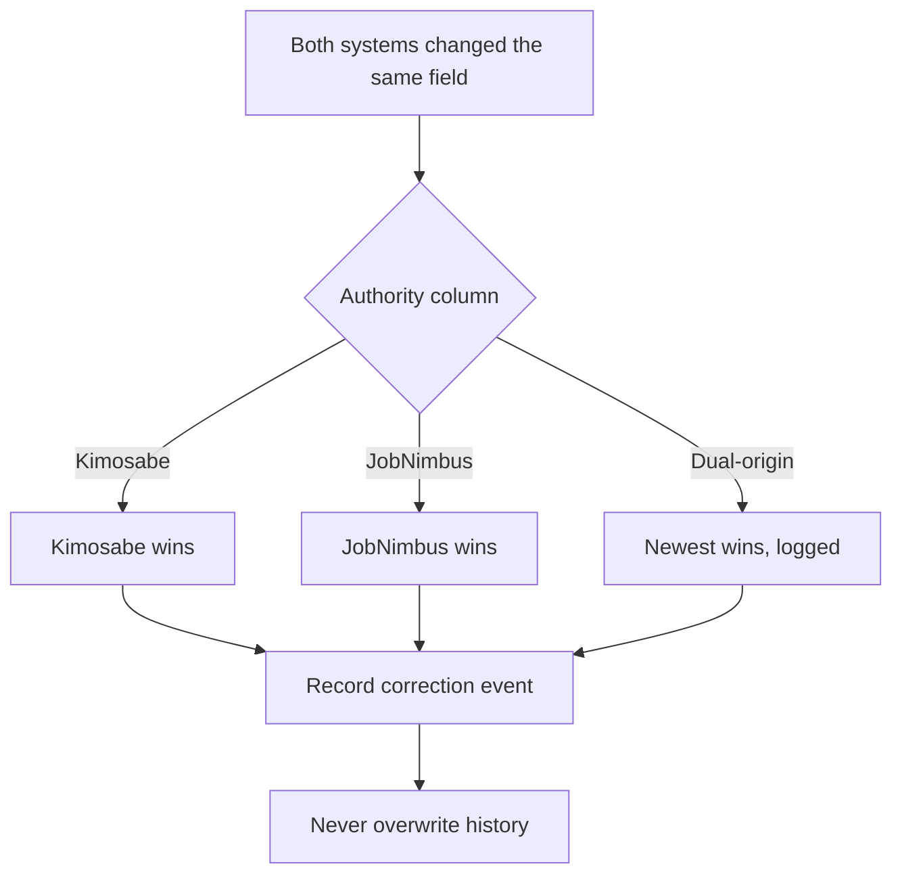

# JobNimbus Integration PRD

**Bundle ID:** B10 · **Package:** B — Executable product definition
**Posture:** Partitioned Federation (field-level authority) — accepted 2026-09-29
**Companion document:** [B11 — JobNimbus Integration SRS](../50-execution/jobnimbus-integration-srs.md)

---

## 1. Document Control

| Field | Value |
|---|---|
| Document ID | `jobnimbus-integration-prd` |
| Bundle ID | B10 |
| Version | v0.1 |
| Status | proposed-ready |
| Owner | Donald Haight |
| Created | 2026-09-29 |
| Architectural posture | Partitioned Federation, accepted 2026-09-29 |
| Customer zero | RRCA (assumed — see VAR-010) |
| Supersedes | None |
| Related | `jobnimbus-integration-recon-brief`, `jobnimbus-integration-architecture-recommendation`, `jobnimbus-integration-srs`, `phase1-prd`, `api-event-schema`, `data-model-master` |

---

## 2. Executive Summary

JobNimbus is the operational nervous system for roofing and exterior contractors. It holds the lead, the job, the estimate, the crew, the photos, the invoice, and the payment. Contractors do not want to replace it, and they should not have to.

Kimosabe is a governance layer: verified people, verified addresses, nested territories, a seasonal clock, an append-only ledger of consequence, and a currency of earned credit. It is not a CRM, and it should never compete with one.

**This integration binds the two without asking a contractor to change tools.**

The governing contract is that **authority is assigned per field, not per system**:

> **JobNimbus owns what the contractor's crew does. Kimosabe owns what the contractor's crew owes.**

JobNimbus remains authoritative on operational execution — schedule, crew, workflow stage, estimates, invoices, payments, evidence capture. Kimosabe becomes authoritative on governance and consequence — verified identity, verified address, territory, season, Group/Designation, the NEED→DONE conversion, commissions, and the ledger.

**The product promise to the contractor is one sentence: *you keep JobNimbus.***

**The first deliverable is one complete loop:** a verified address becomes a lead, becomes a job, advances through the contractor's own workflow, is detected as DONE, writes an append-only ledger event, earns a conversion credit, and posts to the general ledger. One property, one person, one job, one conversion, one credit.

Everything else is later.

---

## 3. Problem Statement

### 3.1 The problem for the contractor

A roofing contractor running JobNimbus today has an excellent operational record and no governance record at all. JobNimbus will tell them a job is complete. It will not tell them:

- Whether the address is **verified** as a distinct, real, annually-resetting unit of need
- Who in a **territory** had the right to work that address
- Which **season** the conversion belongs to, and whether the books should still be open
- What **credit** the conversion earned, and for whom
- Whether the evidence attached to it can be **trusted**
- What the conversion is worth in a **settlement** that clears on a fixed calendar

Every one of those questions is a governance question, and JobNimbus was never designed to answer any of them. That is not a defect in JobNimbus. It is simply a different job.

### 3.2 The problem for the ecosystem

The Human Blockchain's two primitives are **People** and **Addresses**, and its central mechanic is the annual conversion of **NEED → DONE**. Today that mechanic has no operational data source. The conversion happens in the real world, inside a contractor's CRM, and is invisible to the ledger.

Without an operational feed, the ledger records intentions rather than events. Credits become assertions. Commissions become estimates. The seasonal reset has nothing to reset.

### 3.3 The problem for the platform

Building a replacement CRM is the obvious wrong answer. It would require competing with a mature, well-loved, thirteen-year-old product on its home turf; rebuilding scheduling, measurement ordering, payment processing, financing, and mobile photo workflows; and then persuading contractors to abandon the tool their business already runs on.

The established strategy — **Platform Parasitism** — says the opposite: use existing platforms to simulate the future one, conserve engineering resources for the core proprietary architecture, and validate in the real world before building.

### 3.4 The cost of not solving it

| Cost | Consequence |
|---|---|
| No operational feed | The ledger has no events to record; the seasonal model cannot run |
| No verified address | The territory framework has no unit to auction |
| No verified conversion | Credits, commissions, and TER scoring are unfounded |
| No integration path | Contractors cannot participate without abandoning their systems |
| No operational evidence | The valuation framework rests on narrative rather than observed results |

---

## 4. Strategic Fit

This integration is the mechanism by which the Human Blockchain stops being a model and starts being an observation system.

| Kimosabe primitive | How JobNimbus supplies it | Authority after integration |
|---|---|---|
| **People** | Contacts, leads, companies, sales reps, assignees | Kimosabe (identity) / JobNimbus (working data) |
| **Addresses** | Contact and job address fields | **Kimosabe** |
| **NEED → DONE** | Job creation and workflow status advance | **Kimosabe** (state), JobNimbus (stage) |
| **Territory** | — no equivalent — | **Kimosabe** |
| **Season** | — no equivalent — | **Kimosabe** |
| **Groups / Designations** | Partially via record type and assignees | **Kimosabe** |
| **Event Ledger** | Activities, status changes, webhook emissions | **Kimosabe** |
| **Bookkeeping / GL** | Invoices, payments | Kimosabe (GL), JobNimbus (payment processing) |
| **TER / SLA** | Task and job timestamps | **Kimosabe** (scoring) |

**The strategic reading:** JobNimbus can express roughly half of the model. The other half — the half that constitutes the actual invention — has no vendor counterpart at all. The integration's value is concentrated precisely in the gap.

**And the gap is where the moat is.** A competitor can license the same CRM. No competitor can license the territory framework, the seasonal clock, or the ledger.

---

## 5. Users and Personas

| Persona | Posture | What they need | What changes for them |
|---|---|---|---|
| **Property Owner** | Consumer | Nothing new to learn | Nothing. Indirect beneficiary of a faster, cleaner conversion. |
| **Licensed Contractor / GC** (customer zero: RRCA) | Primary operator | Keep JobNimbus exactly as-is; gain verified addresses, territory standing, and a settlement record | Nothing changes in their daily tool. A Kimosabe layer appears beside it. |
| **Independent Sales Rep (ISR) / ReferralTor** | Field actor | Credit for what they brought in, that survives the season | Their conversions become recorded, credited, and defensible. |
| **Office / Production Manager** | Coordinator | Jobs to close cleanly; no duplicate data entry | JobNimbus stays the work surface. Reconciliation is automatic. |
| **Supplier** | External party | Material orders and delivery visibility | Material order status flows into the ecosystem. |
| **Carrier / Adjuster** | External party | Claim evidence that can be trusted | Evidence carries a Kimosabe trust flag. |
| **Founder / Architect** | Governance | Operational truth feeding the ledger and the valuation evidence | Gains an observed-results data source for the first time. |
| **Kimosabe Administrator** | Operator | A per-account provisioning runbook that works | Onboards a contractor account in a bounded, repeatable way. |
| **Hermes Agent** | Automation | A machine-legible contract to execute against | Reads this PRD and the SRS as its specification. |

**Design consequence:** the primary persona is a contractor who has *not* asked for a new system. Every requirement is measured against whether it increases or decreases friction for them. Requirements that increase friction require an explicit justification.

---

## 6. Goals and Success Metrics

### 6.1 Primary goal

**Close one complete loop, end to end, against a real JobNimbus account, with a real contractor's real job — and prove that the ledger recorded it correctly.**

### 6.2 Success metrics

| # | Metric | Target | Measured by |
|---|---|---|---|
| M1 | First loop closes end to end | 1 verified address → 1 job → 1 DONE → 1 ledger event → 1 credit → 1 GL entry | Loop completion checklist |
| M2 | Ledger event correctness | 100% of imported events carry `source_system`, `integration_source`, `external_reference_id`, `authority_source`, and a trust flag | Automated schema assertion |
| M3 | Imported-event trust discipline | 0 imported events treated as trusted without corroboration | Ledger audit query |
| M4 | Reconciliation completeness | 0 missed updates over a 30-day observation window versus a full re-read | Watermark reconciliation report |
| M5 | Duplicate creation rate | 0 duplicate jobs created by dual-origin creation | Merge-key assertion |
| M6 | Write safety | 0 unintended field overwrites in a contractor's production account | Field-diff audit log |
| M7 | Contractor friction | No new data entry required of the contractor | Onboarding walkthrough sign-off |
| M8 | Provisioning time | A new contractor account is fully wired in under 2 hours | Provisioning runbook timing |
| M9 | Schema drift detection | Any JobNimbus response-shape change is detected within 24 hours | Snapshot-and-diff job alert |

### 6.3 Explicit non-goals as metrics

Record counts, sync volume, and API call throughput are **not** success metrics. A million synced records that never close a loop is a failure. This is stated explicitly because it is the most likely way the project drifts.

---

## 7. Scope

### 7.1 In scope — first loop (Phase 1)

| Area | Included |
|---|---|
| Object families | **Contacts** and **Jobs** only |
| Address | Verified address registry; anchoring to contact/job address fields |
| Person | Verified person identity; anchoring to contact records |
| Conversion | NEED → DONE detection from job workflow status |
| Ledger | `INTEGRATION_IMPORT` events with full provenance and trust flag |
| Credit | Conversion credit recorded against the responsible party |
| Bookkeeping | GL entry posted from the conversion |
| Reconciliation | Watermark-driven polling plus webhook acceleration |
| Provisioning | Per-account runbook for wiring automation webhooks |

### 7.2 Explicitly out of scope — first loop

| Excluded | Reason |
|---|---|
| Estimates / proposals | No webhook path; deferred to Phase 2 |
| Invoices / payments | No webhook path; deferred to Phase 2 |
| Work orders / material orders | Production-layer complexity; deferred |
| Files, photos, documents | Evidence trust is Phase 2+ |
| Territory auction | Requires the verified address registry to be populated first |
| TER / SLA scoring | Requires fairness validation (see VAR-007) |
| ClaimsBank conditions | Depends on ledger maturity |
| Commissions and referral fees | Requires the credit mechanism to be proven first |
| Multi-account / multi-tenant provisioning | Single account first (customer zero) |
| Replacement of any JobNimbus function | Never in scope |

### 7.3 Standing scope exclusions

| Exclusion | Rationale |
|---|---|
| Building a CRM | Direct contradiction of Platform Parasitism |
| Requiring contractors to leave JobNimbus | The adoption fight we would lose |
| Treating JobNimbus as the authority on consequence | Architectural posture decision |
| Deleting records in JobNimbus | The API does not permit it, and the bundle forbids deletion |

---

## 8. The Governing Contract — Field-Level Authority Matrix

This matrix is the product's central contract. It is a **living treaty**: fields graduate toward Kimosabe authority as adoption earns it. Changes to this matrix require a decision register entry.

| Object / Field | Authority | Flow | Rationale |
|---|---|---|---|
| Property / Address | **Kimosabe** | K → JN | Verified, annually resetting, territorially nested |
| Person identity (verified) | **Kimosabe** | K → JN | Verified identity is a Human Blockchain primitive |
| Contact working data (phone, email, notes) | JobNimbus | JN → K | Field staff maintain it where they work |
| Lead source | JobNimbus | JN → K | Captured at intake; needed for referral credit |
| Job existence | Dual-origin | ↔ | Either may originate; merged on Address + Party |
| Job schedule / crew / assignees | JobNimbus | JN → K | Pure field operations |
| Job operational status / workflow stage | JobNimbus | JN → K | The contractor's board is truth for execution stage |
| **NEED → DONE conversion state** | **Kimosabe** | K → JN | The core primitive; never delegated |
| **Territory assignment** | **Kimosabe** | K → JN | No JobNimbus equivalent |
| **Season / period** | **Kimosabe** | K → JN | No JobNimbus equivalent |
| **Group / Designation** | **Kimosabe** | K → JN | No JobNimbus equivalent |
| Estimate / Offer content | JobNimbus | JN → K | SumoQuote is genuinely strong |
| Offer version / consent record | **Kimosabe** | K → JN | Consent and legal sensitivity are Kimosabe's |
| Invoice / Payment | JobNimbus | JN → K | Payment processing lives there |
| **Bookkeeping / GL posting** | **Kimosabe** | K only | GL v2 is Kimosabe's; never delegated |
| **Commission / Referral fee** | **Kimosabe** | K → JN | Kimosabe computes TER and commission |
| Evidence / photos / documents | JobNimbus | JN → K | Field capture |
| Evidence verification / trust flag | **Kimosabe** | K → JN | Trust is Kimosabe's to assert |
| **Event ledger** | **Kimosabe** | K only | Append-only spine |
| Task (execution) | JobNimbus | JN → K | Who does what, when |
| Task (protocol obligation) | **Kimosabe** | K → JN | What the protocol requires to be true |

### 8.1 Conflict rule

When both systems modify the same field within a reconciliation window:

1. The **authority column decides the winner** — not recency, not volume.
2. The losing value is recorded as a **correction event**, never silently discarded.
3. A conflict on a **Kimosabe-authoritative** field raises an alert; it should be structurally rare.
4. A conflict on a **JobNimbus-authoritative** field is absorbed silently and logged at debug level.

### 8.2 The elegant consequence

Every Kimosabe-authoritative field flows **K → JN**, written into JobNimbus custom fields. Custom fields never arrive by webhook.

Under this architecture that is **harmless** — we never need them back. The constraint that appeared to be the integration's biggest obstacle is inert. This is the strongest available evidence that the partition line is drawn correctly.

---

## 9. Product Requirements

### 9.1 Functional requirements

| ID | Requirement | Priority | Acceptance criterion |
|---|---|---|---|
| **PRD-FR-001** | The system shall maintain a verified Address registry that is authoritative over JobNimbus address fields. | Must | A Kimosabe address change propagates to the linked JobNimbus contact/job and is visible there. |
| **PRD-FR-002** | The system shall maintain verified Person identity authoritative over JobNimbus contact identity. | Must | A verified person is linked to exactly one JobNimbus contact per account, with a persisted mapping. |
| **PRD-FR-003** | The system shall detect the NEED → DONE conversion from JobNimbus job workflow status and record it as a Kimosabe-owned state transition. | Must | A job reaching its configured terminal status produces exactly one conversion event. |
| **PRD-FR-004** | The system shall write an append-only ledger event for every imported external change that meets the high-consequence threshold. | Must | Ledger contains one event per qualifying change; no updates, no deletes. |
| **PRD-FR-005** | Every imported ledger event shall carry `source_system`, `integration_source`, `external_reference_id`, `authority_source`, `occurred_at`, and `recorded_at`. | Must | Automated schema assertion passes on 100% of imported events. |
| **PRD-FR-006** | Imported events shall be marked untrusted on arrival and shall not be treated as verified until corroborated. | Must | Ledger audit returns zero trusted-without-corroboration imported events. |
| **PRD-FR-007** | The system shall reconcile job and contact state on a watermark-driven schedule independent of webhook delivery. | Must | 30-day observation window shows zero missed updates versus full re-read. |
| **PRD-FR-008** | The system shall accept and process JobNimbus automation webhooks for Contacts, Jobs, Tasks, Work Orders, Material Orders, and Activity where configured. | Should | A configured webhook reduces detection latency without affecting correctness. |
| **PRD-FR-009** | The system shall merge dual-origin job creation on the Address + Party key without creating duplicates. | Must | Zero duplicates across a 30-day window with creation from both sides. |
| **PRD-FR-010** | The system shall record a conversion credit against the responsible party when a conversion is confirmed. | Must | Each DONE conversion yields exactly one credit, attributable to a named party. |
| **PRD-FR-011** | The system shall post a general ledger entry for each confirmed conversion, consistent with GL v2 classes. | Must | Ledger event and GL entry reconcile with zero unexplained variance. |
| **PRD-FR-012** | The system shall expose a per-account provisioning runbook that wires the required JobNimbus automation webhooks. | Should | A new account is fully wired in under 2 hours following the runbook. |
| **PRD-FR-013** | The system shall detect and alert on JobNimbus response-shape changes. | Must | A simulated schema change raises an alert within 24 hours. |
| **PRD-FR-014** | The system shall write Kimosabe-authoritative fields into JobNimbus custom fields and tags without requiring them back. | Should | Territory, season, and designation values are visible in JobNimbus; no read-back dependency exists. |
| **PRD-FR-015** | The system shall record the human actor responsible for each imported write where the API permits attribution. | Should | Writes carry an attributable actor, or are explicitly flagged as unattributed. |
| **PRD-FR-016** | The system shall model record closure as a status transition and shall never attempt deletion in JobNimbus. | Must | No delete calls exist in the codebase; closure is expressed as status. |
| **PRD-FR-017** | The system shall provide a dry-run mode for every write path. | Must | Dry-run produces the intended payload without mutating the target account. |

### 9.2 Non-functional requirements

| ID | Requirement | Target |
|---|---|---|
| **PRD-NFR-001** | Reconciliation latency for a conversion | Under 15 minutes from JobNimbus status change to ledger event |
| **PRD-NFR-002** | Webhook-accelerated latency | Under 60 seconds where a webhook is configured |
| **PRD-NFR-003** | Data loss tolerance | Zero. Every qualifying change is captured by polling even if webhooks fail. |
| **PRD-NFR-004** | Contractor production safety | No unintended field modification; verified by field-diff audit |
| **PRD-NFR-005** | Vendor rate-limit safety | Self-imposed throttle with backoff and circuit breaker; never discovered by incident |
| **PRD-NFR-006** | Auditability | Every imported change traceable to a raw payload with retention |
| **PRD-NFR-007** | Privacy | Personal data handling subject to the bundle's privacy and retention gate |
| **PRD-NFR-008** | Reversibility | The integration can be disabled per account without data loss to either system |

### 9.3 Constraints

| ID | Constraint | Source |
|---|---|---|
| **PRD-C-001** | JobNimbus supports GET, PUT, POST only. No PATCH, no DELETE. | Vendor API |
| **PRD-C-002** | JobNimbus exposes no webhook subscription API; webhooks are automation-rule actions configured per account by a human. | Vendor documentation |
| **PRD-C-003** | Custom fields are never included in webhook payloads. | Vendor documentation |
| **PRD-C-004** | Estimates, invoices, payments, and products have no webhook path. | Vendor documentation |
| **PRD-C-005** | API rate limits are unpublished. | Vendor documentation |
| **PRD-C-006** | There is no published OpenAPI specification, changelog, or deprecation policy. | Recon brief |
| **PRD-C-007** | Queries over 10,000 items require separate handling. | Vendor documentation |
| **PRD-C-008** | API access is plan-gated to the top tier. | Third-party assessment — must be verified (VAR-011) |
| **PRD-C-009** | No sandbox environment is published. | Recon brief |
| **PRD-C-010** | The integration must not require the contractor to change their daily tool. | Platform Parasitism strategy |

---

## 10. Interfaces and Data

### 10.1 External interface summary

| Interface | Direction | Mechanism |
|---|---|---|
| JobNimbus REST API | Bidirectional | HTTPS, Bearer token, JSON |
| JobNimbus automation webhooks | Inbound | HTTP POST to a Kimosabe-hosted endpoint |
| Kimosabe Event Ledger | Internal | Append-only event writes |
| Kimosabe GL v2 | Internal | Journal entry posting |

### 10.2 Identity and merge strategy

| Key | Purpose |
|---|---|
| JobNimbus `jnid` | Primary external identifier. Normalized as the canonical external key. |
| JobNimbus numeric `id` | Maintained in a local mapping table only; never used as the external key. |
| `external_id` field on JobNimbus contacts and jobs | Carries the Kimosabe object identifier — the vendor-intended foreign key. |
| **Address + Party** | The merge key for dual-origin job creation. |

### 10.3 Data requirements

| Requirement | Detail |
|---|---|
| Every mapping persisted | No in-memory-only linkage. Survives restart. |
| Raw payload retention | Every imported change retains its source payload for audit and replay. |
| Watermarks persisted | Reconciliation resumes correctly after interruption without re-processing or skipping. |
| Idempotency | Re-processing the same external change produces no duplicate ledger event. |

---

## 11. Flows and Sequences

### 11.1 The first complete loop

### 11.2 Reconciliation loop

### 11.3 Conflict resolution flow

---

## 12. Phasing and Release

| Phase | Name | Scope | Exit criteria |
|---|---|---|---|
| **0** | Verification and Extraction | Confirm account tier and API access; historical pull; schema map verified against a real account | Account access confirmed; schema map validated against live responses; no write path enabled |
| **1** | The Interlock | Contacts + Jobs; first complete loop; ledger events; conversion credit; GL entry | **M1 achieved** — one real job closes NEED→DONE with a correct ledger event and credit |
| **2** | Commercial Extension | Estimates, invoices, payments reconciled; commissions computed | Commissions reconcile to the contractor's own numbers within tolerance |
| **3** | Governance Push | Territory, Season, Designation written into JobNimbus custom fields and tags | A contractor sees their territory standing inside JobNimbus |
| **4** | Graduation | Selected fields migrate to Kimosabe authority | Adoption metrics justify each graduation; matrix updated with decision entries |

**Phase 0 is valuable on its own and is the correct fallback if any later phase stalls.**

---

## 13. Dependencies

| # | Dependency | Type | Owner | Status |
|---|---|---|---|---|
| D1 | A live JobNimbus account with API access at the required tier | Commercial | Founder | **Unverified — blocking** |
| D2 | Customer zero agreement (RRCA) | Organizational | Founder | Assumed; confirm |
| D3 | Verified Address registry exists in Kimosabe | Technical | Product | Not built |
| D4 | Event Ledger implemented with `INTEGRATION_IMPORT` support | Technical | Engineering | Specified, not built |
| D5 | GL v2 posting interface | Technical | Engineering | Specified, not built |
| D6 | Human available to wire automation webhooks per account | Operational | Contractor / Admin | Process required |
| D7 | Privacy and retention review for customer data | Regulatory | Founder + counsel | Gate exists in register |

**D1 is the hard gate.** Until account access is verified, Phases 1–4 cannot begin. Phase 0 can be scoped but not executed against a live account.

---

## 14. Risks and Mitigations

| # | Risk | Severity | Mitigation |
|---|---|---|---|
| PR1 | No OpenAPI spec — undetectable schema drift | High | Snapshot-and-diff job; contract tests; adapter isolation |
| PR2 | Unpublished rate limits | High | Conservative self-throttle; backoff; circuit breaker; adaptive concurrency |
| PR3 | Webhooks miss estimates, invoices, custom fields | High | Poll-verified architecture; webhooks never establish truth |
| PR4 | Per-account manual webhook wiring | Medium | Provisioning runbook with verification checklist |
| PR5 | API access plan-gated | High | Verify before design commitment; document as commercial dependency |
| PR6 | No sandbox environment | High | Trial account; staged test account; dry-run mode |
| PR7 | Full-object writes clobber fields | Medium | Read-modify-write with field diffing; allow-listed fields only |
| PR8 | Dual-origin duplicates | Medium | Address + Party merge key; idempotency keys |
| PR9 | `api1/v2` sub-surface undocumented | Medium | Single adapter module; feature flag |
| PR10 | `jnid` vs numeric `id` inconsistency | Medium | Normalize on `jnid`; local mapping table |
| PR11 | Discarded error bodies prevent vendor support | Medium | Mandatory raw-payload logging with retention |
| PR12 | Contractor expects Kimosabe to be a CRM | Medium | Positioning discipline; explicit scope exclusion |
| PR13 | Phase 0 mistaken for the finished product | Medium | Explicit phase gates and exit criteria |
| PR14 | Privacy exposure from customer data ingestion | High | Bundle privacy gate; retention limits; consent review |

---

## 15. Open Questions

| # | Question | Authority | Impact if unanswered |
|---|---|---|---|
| Q1 | Is there a live JobNimbus account with API access, and at which tier? | Founder | Blocks Phases 1–4 entirely |
| Q2 | Is RRCA confirmed as customer zero for the first loop? | Founder | Changes provisioning and case-study framing |
| Q3 | Does the contractor-facing promise remain "you keep JobNimbus"? | Founder | Affects positioning across all seven sites |
| Q4 | Should Phase 0 extraction begin immediately as an independent workstream? | Founder | Determines whether value starts accruing now |
| Q5 | What is the corroboration rule that promotes an imported event from untrusted to trusted? | Founder + Product | Determines ledger trust semantics |
| Q6 | Does JobNimbus `record type` / `workflow type` vocabulary inform the Group vs. Designation classification? | Founder | Could accelerate the taxonomy decision |
| Q7 | What is the retention period for raw JobNimbus payloads? | Founder + counsel | Privacy gate dependency |

---

## 16. Appendix A — Glossary

| Term | Definition |
|---|---|
| **Address** | A verified, annually-resetting real property unit. One of the two Kimosabe primitives. |
| **Person** | A verified individual. The other Kimosabe primitive. |
| **NEED → DONE** | The annual conversion mechanic. Every address resets to NEED; someone earns credit for converting it. |
| **Conversion credit** | The earned record that a party converted an address from NEED to DONE. |
| **Partitioned Federation** | The accepted posture: authority assigned per field, not per system. |
| **Interlock Method** | The six-step procedure (Anchor, Partition, Absorb, Translate, Reconcile, Graduate) for connecting a protocol to an external system. |
| **jnid** | The JobNimbus identifier exposed on webhook payloads. The canonical external key. |
| **Watermark** | The `date_updated` high-water mark from which reconciliation resumes. |
| **Trust flag** | The marker distinguishing corroborated ledger events from unverified imports. |
| **Graduation** | The migration of a field from external authority to Kimosabe authority as adoption earns it. |

## 17. Appendix B — Traceability

| PRD requirement | SRS section | Test |
|---|---|---|
| PRD-FR-001 – 002 | Identity Resolution | SRS-T-001 – 003 |
| PRD-FR-003 | Conversion Detection | SRS-T-004 |
| PRD-FR-004 – 006 | Ledger Translation | SRS-T-005 – 008 |
| PRD-FR-007 – 008 | Reconciliation Engine | SRS-T-009 – 012 |
| PRD-FR-009 | Merge and Idempotency | SRS-T-013 – 014 |
| PRD-FR-010 – 011 | Credit and GL Posting | SRS-T-015 – 016 |
| PRD-FR-013 | Contract Verification | SRS-T-017 |
| PRD-FR-016 – 017 | Write Guardrails | SRS-T-018 – 019 |

---

## 18. Bibliography

| ID | Source | Type | Retrieved |
|---|---|---|---|
| S1 | `documenter.getpostman.com/view/3919598/S11PpG4x` — JobNimbus Public API | Official | 2026-09-29 |
| S2 | `support.jobnimbus.com/how-do-i-create-an-integration-using-jobnimbuss-open-api` | Official | 2026-09-29 |
| S3 | `support.jobnimbus.com/what-are-the-different-actions-i-can-have-an-automation-execute` — webhook field inventory | Official | 2026-09-29 |
| S5 | `github.com/clykins90/jobnimbus-mcp-server` — community reference implementation | Community | 2026-09-29 |
| S6 | `github.com/api-evangelist/jobnimbus` — independent API profile | Third-party | 2026-09-29 |
| S7 | `supergood.ai/api-report-card/jobnimbus` — plan gating and grading | Third-party | 2026-09-29 |
| S8 | `supergood.ai/docs/jobnimbus-api` — integration friction analysis | Third-party | 2026-09-29 |
| S9 | `dlthub.com/context/source/jobnimbus` — pipeline harness | Third-party | 2026-09-29 |
| S10 | `docs.nexla.com/user-guides/connectors/job_nimbus_api` — connector semantics | Third-party | 2026-09-29 |
| S11 | `usecarly.com/blog/claude-jobnimbus-integration/` — MCP landscape | Third-party | 2026-09-29 |
| S12 | `github.com/donaldhaight/human-blockchain-operating-system` — OKF Bundle v0.2 | Internal | 2026-09-29 |

---

*End of PRD. The engineering specification is B11 — JobNimbus Integration SRS.*
