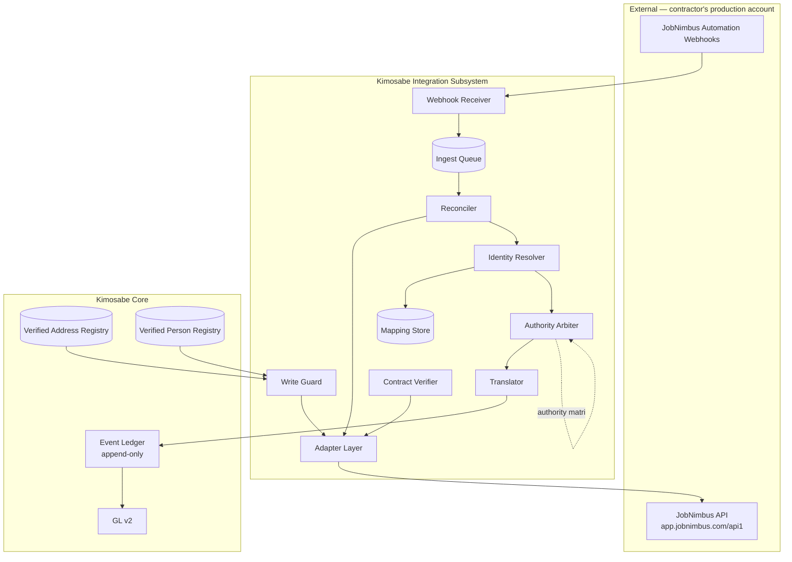
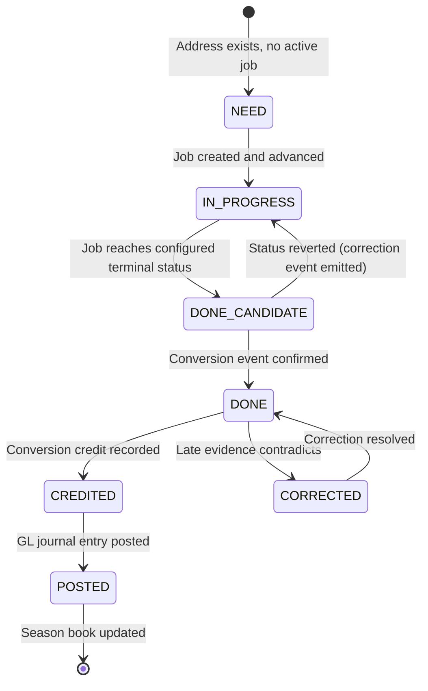
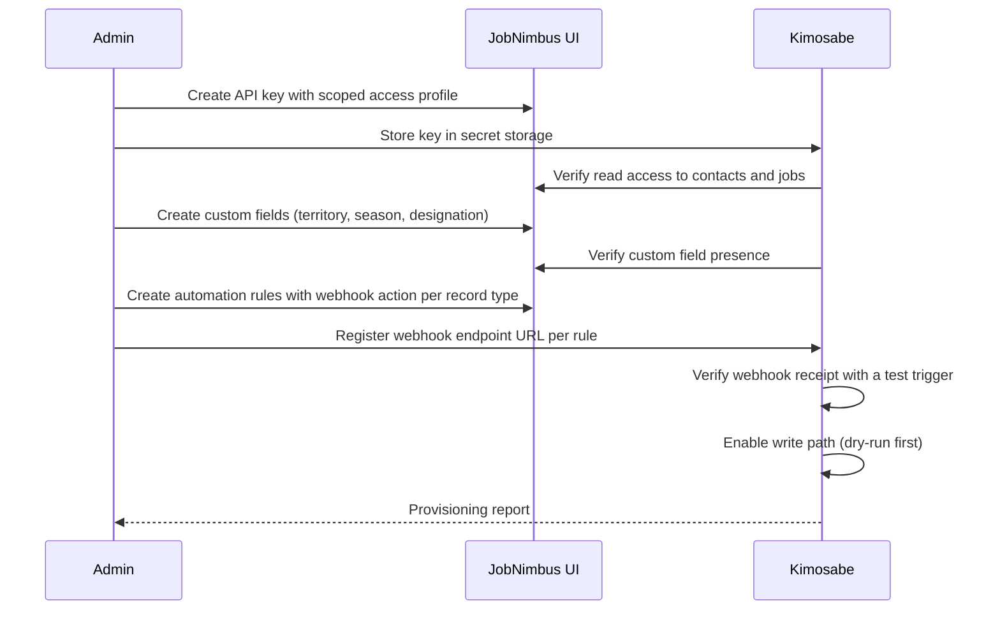

# JobNimbus Integration SRS

**Bundle ID:** B11 · **Package:** B — Executable product definition
**Implements:** [B10 — JobNimbus Integration PRD](../20-product/jobnimbus-integration-prd.md)
**Posture:** Partitioned Federation (field-level authority) — accepted 2026-09-29

---

## 1. Document Control

| Field | Value |
|---|---|
| Document ID | `jobnimbus-integration-srs` |
| Bundle ID | B11 |
| Version | v0.1 |
| Status | proposed-ready |
| Owner | Donald Haight |
| Created | 2026-09-29 |
| Implements | `jobnimbus-integration-prd` |
| Conforms to | `api-event-schema`, `data-dictionary-field-naming`, `data-model-master` |
| Related | `jobnimbus-integration-recon-brief`, `jobnimbus-integration-architecture-recommendation` |

---

## 2. Introduction

### 2.1 Purpose

This document specifies the software required to implement the JobNimbus integration defined in the PRD. It is written to be executable by both human developers and autonomous agents (Hermes), and it is the authoritative source for architecture, interfaces, data mappings, and verification criteria.

### 2.2 Scope

**In scope:** the adapter layer, reconciliation engine, identity resolution, authority arbitration, ledger translation, write guardrails, contract verification, and per-account provisioning for the Contacts and Jobs object families.

**Out of scope:** estimates, invoices, payments, work orders, material orders, files, territory auction, TER scoring, ClaimsBank conditions, and multi-tenant provisioning. See PRD §7.2.

### 2.3 Definitions

| Term | Definition |
|---|---|
| **Adapter** | The isolated module that speaks to the JobNimbus API. The only place vendor specifics are permitted. |
| **Reconciler** | The watermark-driven component that detects external state change. |
| **Identity Resolver** | The component that maps JobNimbus identifiers to Kimosabe objects. |
| **Authority Arbiter** | The component that applies the field-level authority matrix to a detected change. |
| **Translator** | The component that converts an external change into a ledger event. |
| **Write Guard** | The component that protects the contractor's production account from unsafe writes. |
| **Watermark** | The persisted `date_updated` high-water mark for a resource stream. |
| **Overlap window** | A deliberate re-read period behind the watermark to absorb clock skew and vendor write delay. |
| **Trust flag** | The marker distinguishing corroborated events from unverified imports. |

### 2.4 References

| Ref | Document |
|---|---|
| R1 | `jobnimbus-integration-prd` — B10 |
| R2 | `api-event-schema` — event ledger schema, categories, rules |
| R3 | `data-dictionary-field-naming` — naming, ID formats, enums |
| R4 | `data-model-master` — object families |
| R5 | `jobnimbus-integration-recon-brief` — verified vendor surface |

---

## 3. Overall Description

### 3.1 Product perspective

The integration is a **subsystem of the Kimosabe application**, not a standalone service. It consumes the JobNimbus Open API as an external observed system and produces append-only ledger events and bookkeeping entries.



### 3.2 Core architectural principle

> **Vendor specifics live in exactly one place: the Adapter.**

No other component may construct a JobNimbus URL, parse a JobNimbus payload shape, or know a JobNimbus field name. This is the primary defense against an undocumented, unversioned vendor surface (PRD-C-006).

### 3.3 User characteristics

| User | Interaction |
|---|---|
| Contractor | None directly. Benefits flow through JobNimbus. |
| Kimosabe Admin | Runs the provisioning runbook; monitors health |
| Hermes Agent | Executes provisioning steps; reads alerts; may draft corrections |
| Developer | Works within the Adapter for vendor changes |

### 3.4 Constraints

All PRD-C-001 through PRD-C-010 apply and are restated here as binding engineering constraints:

| ID | Engineering consequence |
|---|---|
| PRD-C-001 | No `DELETE` verb exists in the Adapter. No `PATCH` verb exists. Closure is a status write. |
| PRD-C-002 | Webhook registration is **not** a code path. It is a human-executed provisioning step. |
| PRD-C-003 | Any Kimosabe-authoritative field written to JobNimbus is **write-only** from our perspective. No read-back logic may depend on it. |
| PRD-C-004 | Estimates, invoices, payments, and products are poll-only when they enter scope in Phase 2. |
| PRD-C-005 | The Adapter ships with a default throttle, backoff, and circuit breaker **before** first contact with a live account. |
| PRD-C-007 | Any fetch approaching 10,000 items must chunk by time window rather than paginate deeper. |
| PRD-C-008 | Account tier must be verified in Phase 0 before any write path is enabled. |
| PRD-C-009 | A trial or controlled test account is the development target. |
| PRD-C-010 | No requirement may add data entry for the contractor. |

### 3.5 Assumptions

| ID | Assumption | If false |
|---|---|---|
| VAR-010 | Customer zero is RRCA | Re-scope provisioning and case-study framing |
| VAR-011 | Account is at a tier with API access | Phases 1–4 blocked; Phase 0 becomes the only deliverable |
| VAR-012 | `jnid` is stable across the record lifetime | Identity strategy must fall back to numeric `id` with re-mapping |
| VAR-013 | The `external_id` field is writable on contacts and jobs | Merge key must move to a custom field or a mapping-only strategy |
| VAR-014 | `date_updated` advances monotonically | Watermark strategy requires a secondary corroborating signal |

**VAR-014 is load-bearing and must be verified in Phase 0 before any build work begins.** If `date_updated` is not monotonic, the watermark strategy fails silently and changes are lost. VAR-013 (`external_id` writability) must be verified in the same pass.

---

## 4. System Architecture

### 4.1 Component responsibilities

| Component | Responsibility | Must not |
|---|---|---|
| **Adapter Layer** | Construct requests, authenticate, throttle, retry, parse responses, normalize to internal shapes | Contain business rules |
| **Webhook Receiver** | Accept inbound POSTs, validate origin, persist raw payload, enqueue | Write to the ledger directly |
| **Ingest Queue** | Durable buffer decoupling receipt from processing | Lose a message on restart |
| **Reconciler** | Watermark management, overlap-window fetch, change detection | Assume webhooks are complete |
| **Identity Resolver** | Map `jnid` and `external_id` to Kimosabe objects; maintain the Mapping Store | Create duplicate mappings |
| **Authority Arbiter** | Apply the field-level authority matrix; classify each change | Invent authority not in the matrix |
| **Translator** | Convert a change into a ledger event with full provenance | Emit an event without a trust flag |
| **Write Guard** | Read-modify-write, field diffing, allow-list enforcement, dry-run | Blind PUT; write a field not on the allow-list |
| **Contract Verifier** | Snapshot response shapes; diff; alert on drift | Auto-adapt silently |
| **Mapping Store** | Persist all identity mappings | Hold mappings only in memory |

### 4.2 Isolation boundaries

```text
┌─────────────────────────────────────────────────────────┐
│ VENDOR ISOLATION BOUNDARY                               │
│   Only the Adapter may cross it.                        │
│   Only the Adapter may know: api1, v2, jnid, cf_*,      │
│   actor=, skip=, bulk=, ElasticSearch filter syntax.    │
└─────────────────────────────────────────────────────────┘
```

**Verification:** a static analysis check asserts that no module outside the Adapter references vendor strings. This is a build-time gate, not a convention.

### 4.3 Deployment posture

| Aspect | Decision |
|---|---|
| Execution model | Scheduled reconciliation job plus an always-on webhook endpoint |
| Statefulness | Stateless workers with durable state in the Mapping Store and watermarks table |
| Failure isolation | One account's failure must not stall another's (relevant from Phase 3) |
| Kill switch | Per-account disable that halts writes while preserving reads |

---

## 5. External Interface Requirements

### 5.1 JobNimbus REST interface

| ID | Requirement |
|---|---|
| **SRS-IF-001** | The Adapter shall target base URL `https://app.jobnimbus.com/api1/`. |
| **SRS-IF-002** | The Adapter shall authenticate with header `Authorization: Bearer <key>`, with the key sourced from environment or secret storage — never hardcoded, never logged. |
| **SRS-IF-003** | The Adapter shall support the optional `actor` query parameter for write attribution where an admin-level profile is available. |
| **SRS-IF-004** | The Adapter shall support the query parameters `size`, `from`, `sort_field`, `sort_direction`, `fields`, `filter`, `bulk`, and `skip`. |
| **SRS-IF-005** | The Adapter shall default `size` to a conservative value (≤250) rather than the vendor maximum of 1000, to bound response time and memory. |
| **SRS-IF-006** | The Adapter shall construct `filter` as URL-encoded JSON using the vendor's ElasticSearch-style syntax. |
| **SRS-IF-007** | The Adapter shall support the `terms` clause for multi-identifier fetches. |
| **SRS-IF-008** | The Adapter shall escape `\b \f \n \r \t \" \\` in every payload before transmission. |
| **SRS-IF-009** | The Adapter shall set `Content-Type: application/json` and shall treat `415` and `422` as payload-hygiene failures with the offending field identified. |
| **SRS-IF-010** | The Adapter shall persist the full raw error body on any non-200 response, because the vendor cannot assist without it. |
| **SRS-IF-011** | The Adapter shall never issue `DELETE` or `PATCH`. |
| **SRS-IF-012** | The Adapter shall isolate any `api1/v2` call behind a feature flag and a single module boundary. |
| **SRS-IF-013** | The Adapter shall chunk any fetch approaching 10,000 items by time window rather than paginating deeper. |

### 5.2 Webhook interface

| ID | Requirement |
|---|---|
| **SRS-IF-014** | The system shall expose an HTTPS POST endpoint per account to receive JobNimbus automation webhooks. |
| **SRS-IF-015** | The receiver shall validate origin using the available authentication mechanism configured on the JobNimbus automation action. |
| **SRS-IF-016** | The receiver shall persist the raw payload **before** acknowledging, and shall enqueue rather than process inline. |
| **SRS-IF-017** | The receiver shall return 2xx quickly; processing latency must not be coupled to delivery acknowledgement. |
| **SRS-IF-018** | The receiver shall be idempotent — duplicate deliveries must not produce duplicate ledger events. |
| **SRS-IF-019** | The system shall document that webhook configuration is a **human provisioning step** per account, per record type. |

### 5.3 Ledger interface

| ID | Requirement |
|---|---|
| **SRS-IF-020** | Every imported event shall conform to the `api-event-schema` event object. |
| **SRS-IF-021** | Every imported event shall set `event_category: INTEGRATION_IMPORT`. |
| **SRS-IF-022** | Every imported event shall set `source_system`, `integration_source`, `external_reference_id`, `authority_source`, `occurred_at`, and `recorded_at`. |
| **SRS-IF-023** | Every imported event shall carry a trust flag, defaulting to **untrusted**. |
| **SRS-IF-024** | Corrections shall emit `correction_of_event_id`; re-reads after watermark advance shall emit `supersedes_event_id`. No imported event shall be updated or deleted. |
| **SRS-IF-025** | Events with `legal_sensitivity: HIGH` shall carry a safe label per ledger Rule 5. |

### 5.4 GL interface

| ID | Requirement |
|---|---|
| **SRS-IF-026** | A confirmed conversion shall post a journal entry consistent with GL v2 account classes. |
| **SRS-IF-027** | The posting shall be idempotent per conversion; a replayed event must not double-post. |
| **SRS-IF-028** | Posting failures shall be retried with backoff and shall surface as operational alerts, never silently dropped. |

---

## 6. Data Requirements

### 6.1 Identity and merge strategy

| ID | Requirement |
|---|---|
| **SRS-DR-001** | The system shall treat `jnid` as the canonical external identifier. |
| **SRS-DR-002** | The system shall maintain a persistent Mapping Store keyed on `jnid`, holding the Kimosabe object reference and the numeric vendor `id` where observed. |
| **SRS-DR-003** | The system shall use the vendor `external_id` field to carry the Kimosabe object identifier on contacts and jobs. |
| **SRS-DR-004** | The system shall merge dual-origin job creation on the **Address + Party** key. |
| **SRS-DR-005** | The system shall generate an idempotency key per (external change, target object) pair and shall reject re-processing of a seen key. |
| **SRS-DR-006** | The system shall never rely on the numeric vendor `id` as a durable external key. |

### 6.2 Field mapping — Contacts

| Kimosabe field | JobNimbus field | Authority | Direction |
|---|---|---|---|
| Person verified identity | `display name`, `first name`, `last name` | Kimosabe (identity) | K → JN |
| Contact working phone | `mobile phone`, `home phone`, `work phone` | JobNimbus | JN → K |
| Contact email | `email` | JobNimbus | JN → K |
| Company | `company` | JobNimbus | JN → K |
| Address line 1 | `address line1` | **Kimosabe** | K → JN |
| Address line 2 | `address line2` | **Kimosabe** | K → JN |
| City | `city` | **Kimosabe** | K → JN |
| State | `state text` | **Kimosabe** | K → JN |
| Postal code | `zip` | **Kimosabe** | K → JN |
| Territory | custom field | **Kimosabe** | K → JN |
| Season | custom field | **Kimosabe** | K → JN |
| Designation | tag or custom field | **Kimosabe** | K → JN |
| Lead source | `source name` | JobNimbus | JN → K |
| Sales rep | `sales rep`, `sales rep email`, `sales rep name` | JobNimbus | JN → K |
| Assignees | `owners` | JobNimbus | JN → K |
| Status | `status name` | JobNimbus | JN → K |
| External reference | `external id` | Kimosabe (write) | K → JN |

### 6.3 Field mapping — Jobs

| Kimosabe field | JobNimbus field | Authority | Direction |
|---|---|---|---|
| Project / Job existence | record presence | Dual-origin | ↔ |
| Job name | `name` | JobNimbus | JN → K |
| Job number | `number` | JobNimbus | JN → K |
| Operational status / stage | `status name`, workflow | JobNimbus | JN → K |
| Status change timestamp | `date status change` | JobNimbus | JN → K |
| Start / end dates | `date start`, `date end` | JobNimbus | JN → K |
| Assignees | `owners` | JobNimbus | JN → K |
| Sales rep | `sales rep`, `sales rep name` | JobNimbus | JN → K |
| Primary contact linkage | `primary id`, `primary name`, `primary type` | JobNimbus | JN → K |
| Related records | `related` | JobNimbus | JN → K |
| Property address | `address line1`, `city`, `state text`, `zip` | **Kimosabe** | K → JN |
| **NEED → DONE conversion** | derived from `status name` | **Kimosabe** | K → JN |
| Territory / Season / Designation | custom fields, tags | **Kimosabe** | K → JN |
| External reference | `external id` | Kimosabe (write) | K → JN |
| Source | `source name` | JobNimbus | JN → K |

### 6.4 Custom field handling

| ID | Requirement |
|---|---|
| **SRS-DR-007** | Custom fields written to JobNimbus shall be treated as **write-only**. No logic may depend on reading them back. |
| **SRS-DR-008** | Where a custom field label is a legacy system label (`cf_string_1` pattern), the Adapter shall resolve it through a maintained label map rather than hardcoding. |
| **SRS-DR-009** | Custom field type mapping shall follow vendor semantics: Text→String, Date→Date, Number→Long, Decimal→Double, Boolean→true/false, Options list→comma-separated string. |
| **SRS-DR-010** | The system shall detect and alert if a required custom field is missing from an account. |

### 6.5 Raw payload retention

| ID | Requirement |
|---|---|
| **SRS-DR-011** | Every imported change shall retain its raw source payload for audit and replay. |
| **SRS-DR-012** | Retention period shall be set by the bundle privacy gate (see PRD Q7) and shall be configurable, not hardcoded. |
| **SRS-DR-013** | Raw payloads shall be stored in a manner that supports replay of the translation step without re-fetching from the vendor. |
| **SRS-DR-014** | The system shall specify and apply a timezone mapping between JobNimbus Unix timestamps, JobNimbus human-readable date fields, and the ledger's ISO-8601 `occurred_at`. No timestamp shall be stored without an explicit timezone basis. |
| **SRS-DR-015** | Where a JobNimbus address cannot be normalized to a verified Kimosabe address with confidence, the record shall enter a **merge review queue** rather than being auto-merged. Merge shall not be silently best-effort. |

---

## 7. Functional Requirements

### 7.1 Identity resolution

| ID | Requirement | Verification |
|---|---|---|
| **SRS-FR-001** | The Identity Resolver shall resolve an inbound `jnid` to a Kimosabe object, creating the mapping if absent. | SRS-T-001 |
| **SRS-FR-002** | The resolver shall prefer `external_id` when present, and shall reconcile it against the `jnid` mapping. | SRS-T-002 |
| **SRS-FR-003** | The resolver shall never create a second mapping for the same `jnid`. | SRS-T-003 |

### 7.2 Change detection and reconciliation

| ID | Requirement | Verification |
|---|---|---|
| **SRS-FR-004** | The Reconciler shall fetch by `date_updated > watermark`, minus a configurable overlap window. | SRS-T-009 |
| **SRS-FR-005** | The Reconciler shall advance the watermark only after a change is fully processed and its ledger event is committed. | SRS-T-010 |
| **SRS-FR-006** | The Reconciler shall run on a schedule independent of webhook receipt. | SRS-T-011 |
| **SRS-FR-007** | The Reconciler shall detect and log the delta between webhook-observed and poll-observed change sets over a rolling window. | SRS-T-012 |
| **SRS-FR-008** | The Reconciler shall resume correctly after interruption without re-processing committed changes or skipping unprocessed ones. | SRS-T-020 |

### 7.3 Authority arbitration

| ID | Requirement | Verification |
|---|---|---|
| **SRS-FR-009** | The Authority Arbiter shall classify every detected change against the field-level authority matrix. | SRS-T-021 |
| **SRS-FR-010** | A change to a JobNimbus-authoritative field shall be absorbed and logged at debug level. | SRS-T-022 |
| **SRS-FR-011** | A change to a Kimosabe-authoritative field detected inbound shall raise a conflict alert. | SRS-T-023 |
| **SRS-FR-012** | A change to a dual-origin field shall apply newest-wins and shall be logged. | SRS-T-024 |
| **SRS-FR-013** | The Arbiter shall never assign authority not present in the matrix; an unclassified field shall fail closed to alert. | SRS-T-025 |

### 7.4 Conversion detection

| ID | Requirement | Verification |
|---|---|---|
| **SRS-FR-014** | The system shall detect NEED → DONE when a job reaches a configured terminal workflow status for its workflow type. | SRS-T-004 |
| **SRS-FR-015** | The terminal status mapping shall be configuration per account and per workflow type — never hardcoded. | SRS-T-026 |
| **SRS-FR-016** | The system shall emit exactly one conversion event per job per season, and shall suppress duplicates caused by status flapping. | SRS-T-027 |
| **SRS-FR-017** | A job leaving the terminal status shall emit a correction event, never a deletion. | SRS-T-028 |

### 7.5 Ledger translation

| ID | Requirement | Verification |
|---|---|---|
| **SRS-FR-018** | The Translator shall emit one ledger event per qualifying external change. | SRS-T-005 |
| **SRS-FR-019** | Every emitted event shall carry the mandatory provenance fields from SRS-IF-022. | SRS-T-006 |
| **SRS-FR-020** | Every emitted event shall be written with trust flag **untrusted**. | SRS-T-007 |
| **SRS-FR-021** | The system shall promote an event to corroborated when the same state is independently observed in a subsequent reconciliation cycle, or when webhook and poll agree on the change. | SRS-T-008 |
| **SRS-FR-022** | The Translator shall be replayable from stored raw payloads without vendor re-fetch. | SRS-T-029 |

> **Note — open design decision, and a legal one.** SRS-FR-021 states a **proposed** corroboration rule. The authoritative rule is PRD Q5 and is not yet decided. This requirement is marked `proposed` and must be confirmed before Phase 1 exit.
>
> **Counsel review required.** Promoting an imported event from `untrusted` to `trusted` is functionally an **attestation** that the recorded state is correct. Where a credit, commission, or settlement depends on that promotion, the promotion is a consequential act. Q5 is therefore a counsel question as well as a product question.

### 7.6 Credit and bookkeeping

| ID | Requirement | Verification |
|---|---|---|
| **SRS-FR-023** | A confirmed conversion shall produce exactly one conversion credit attributable to a named party. | SRS-T-015 |
| **SRS-FR-024** | A confirmed conversion shall post exactly one GL journal entry. | SRS-T-016 |
| **SRS-FR-025** | Credit and GL posting shall be idempotent against the conversion event identifier. | SRS-T-030 |

### 7.7 Write path and guardrails

| ID | Requirement | Verification |
|---|---|---|
| **SRS-FR-026** | All writes shall be read-modify-write with explicit field diffing. | SRS-T-018 |
| **SRS-FR-027** | Writes shall be restricted to an allow-list of fields derived from the authority matrix. | SRS-T-031 |
| **SRS-FR-028** | Every write path shall support dry-run mode producing the intended payload without mutation. | SRS-T-019 |
| **SRS-FR-029** | Every write shall record a field-diff audit entry showing before and after values. | SRS-T-032 |
| **SRS-FR-030** | The system shall attribute writes to a human actor via the `actor` parameter where an admin-level profile is available; otherwise it shall flag the write as unattributed. | SRS-T-033 |
| **SRS-FR-031** | The system shall never issue a write against a production account while in dry-run mode. | SRS-T-034 |

### 7.8 Contract verification

| ID | Requirement | Verification |
|---|---|---|
| **SRS-FR-032** | The Contract Verifier shall snapshot response shapes for each in-scope resource on a daily schedule. | SRS-T-017 |
| **SRS-FR-033** | The verifier shall diff snapshots and raise an alert on any shape change. | SRS-T-035 |
| **SRS-FR-034** | The verifier shall never auto-adapt to a shape change; adaptation requires a reviewed code change. | SRS-T-036 |
| **SRS-FR-035** | Contract tests shall assert the required fields for each in-scope resource are present and correctly typed. | SRS-T-037 |

### 7.9 Provisioning

| ID | Requirement | Verification |
|---|---|---|
| **SRS-FR-036** | The system shall provide a per-account provisioning runbook covering API key creation, access profile scoping, custom field creation, and webhook wiring. | SRS-T-038 |
| **SRS-FR-037** | The system shall verify provisioning completeness and report any missing element before enabling writes. | SRS-T-039 |
| **SRS-FR-038** | The system shall route a record that repeatedly fails processing to a dead-letter queue after a bounded retry count, so that one poison record cannot stall the watermark indefinitely. Dead-lettered records shall be alerted and replayable. | SRS-T-053 |

---

## 8. Non-Functional Requirements

| ID | Requirement | Target | Verification |
|---|---|---|---|
| **SRS-NFR-001** | Reconciliation cycle completion | Under 15 minutes per cycle at expected volume | SRS-T-040 |
| **SRS-NFR-002** | Webhook-to-ledger latency | Under 60 seconds, p95 | SRS-T-041 |
| **SRS-NFR-003** | Vendor call volume | Self-imposed ceiling with adaptive concurrency; no vendor limit discovery by incident | SRS-T-042 |
| **SRS-NFR-004** | Resilience | Exponential backoff, jitter, circuit breaker on repeated failure | SRS-T-043 |
| **SRS-NFR-005** | Data loss | Zero. Polling captures every qualifying change regardless of webhook state. | SRS-T-044 |
| **SRS-NFR-006** | Write safety | Zero unintended field modifications; verified by field-diff audit | SRS-T-045 |
| **SRS-NFR-007** | Observability | Every cycle emits metrics for fetched, changed, translated, written, conflicted, and errored counts | SRS-T-046 |
| **SRS-NFR-008** | Secret handling | API keys sourced from secret storage; never logged, never in source control | SRS-T-047 |
| **SRS-NFR-009** | Auditability | Every imported change traceable to a retained raw payload | SRS-T-048 |
| **SRS-NFR-010** | Reversibility | Per-account disable halts writes while preserving reads and history | SRS-T-049 |
| **SRS-NFR-011** | Idempotency | Replay of any stored payload produces no duplicate side effect | SRS-T-050 |
| **SRS-NFR-012** | Restart safety | Any component may restart at any point without data loss or duplication | SRS-T-051 |

---

## 9. Behavioral Specifications

### 9.1 Reconciliation algorithm

```text
PROCEDURE reconcile(account, resource):
  watermark   ← load_persisted_watermark(account, resource)
  window_start ← watermark − OVERLAP_WINDOW
  cursor      ← window_start

  LOOP:
    batch ← adapter.fetch(
               resource,
               filter = { date_updated: { gt: cursor } },
               sort_field = 'date_updated',
               sort_direction = 'asc',
               size = 250 )

    IF batch is empty: BREAK

    FOR EACH record IN batch:
      change ← detect_change(record)          # diff vs last-known state
      IF change is none: CONTINUE

      identity ← resolve_identity(record)      # jnid + external_id
      class    ← arbitrate(change)             # authority matrix

      SWITCH class:
        CASE jobnimbus_authoritative:
          absorb_and_log_debug(change)
        CASE kimosabe_authoritative:
          raise_conflict_alert(change)
        CASE dual_origin:
          apply_newest_wins(change); log(change)
        CASE unclassified:
          raise_alert_and_halt_batch(change)   # fail closed
        CASE internal:
          event ← translate(change)
          ledger.append(event, trust = UNTRUSTED)
          on_conversion(event) → credit + GL post

      cursor ← max(cursor, record.date_updated)

    persist_watermark(account, resource, cursor)   # only after commit
```

**Critical property:** the watermark advances **only** after every record in the batch has been fully processed and committed. A crash mid-batch re-processes from the last persisted watermark; idempotency (SRS-DR-005) makes re-processing safe.

### 9.2 Conversion state machine



Every transition emits an event. No transition deletes a prior event.

### 9.3 Trust promotion

```text
UNTRUSTED  ──[same state observed in a subsequent independent cycle]──▶ CORROBORATED
UNTRUSTED  ──[webhook and poll agree on the change]───────────────────▶ CORROBORATED
UNTRUSTED  ──[contradicted by a later observation]────────────────────▶ SUPERSEDED
```

A `SUPERSEDED` event is not deleted; it emits `supersedes_event_id` on the replacing event.

### 9.4 Provisioning sequence



---

## 10. Error Handling and Edge Cases

| # | Condition | Required behavior |
|---|---|---|
| E1 | Non-200 response | Persist full raw body; classify; retry with backoff on 5xx/429; fail fast on 4xx |
| E2 | `415` / `422` payload rejection | Identify offending field; log the exact payload; do not retry blindly |
| E3 | Circuit breaker open | Halt the affected resource stream; alert; preserve watermark; resume only on manual or timed recovery |
| E4 | Webhook delivered twice | Idempotency key suppresses duplicate event |
| E5 | Webhook arrives for an unknown record | Enqueue; resolve on next reconciliation; never create a speculative mapping |
| E6 | `jnid` missing from payload | Fall back to numeric `id` with a warning; log as a contract deviation |
| E7 | `date_updated` goes backwards | Do not rewind the watermark; emit a contract alert |
| E8 | Job status flaps DONE → IN_PROGRESS → DONE | One conversion event; second DONE suppressed within the season |
| E9 | Record deleted in JobNimbus (via UI) | Not representable via API; detected as absence; emit a closure event; never delete locally |
| E10 | Address changed on a job mid-project | Emit an address-change event; re-resolve territory; flag for review |
| E11 | Custom field missing from account | Alert during provisioning; block the dependent write path |
| E12 | Bulk write delay hides a record from search | Overlap window absorbs it; if not, the next cycle catches it |
| E13 | Two Kimosabe records map to one `jnid` | Fail closed; alert; never auto-merge |
| E14 | Rate limit approached | Reduce concurrency proactively before the ceiling; never discover by failure |
| E15 | Ledger write succeeds but GL post fails | Retry GL; conversion remains valid; alert on persistent failure |
| E16 | Vendor response shape changes | Contract Verifier alerts; Adapter fails closed rather than mis-parsing |
| E17 | Approaching 10,000 items in a window | Chunk by time window automatically; log the chunking decision |

---

## 11. Verification Requirements

| ID | Test | Type |
|---|---|---|
| **SRS-T-001** | Resolve a known `jnid` to its Kimosabe object | Unit |
| **SRS-T-002** | `external_id` preferred and reconciled against `jnid` | Unit |
| **SRS-T-003** | Duplicate mapping attempt is rejected | Unit |
| **SRS-T-004** | Terminal status produces exactly one conversion event | Integration |
| **SRS-T-005** | One qualifying change produces exactly one ledger event | Integration |
| **SRS-T-006** | Mandatory provenance fields present on 100% of imported events | Assertion |
| **SRS-T-007** | Newly imported events are untrusted | Assertion |
| **SRS-T-008** | Corroboration promotes to trusted exactly once | Integration |
| **SRS-T-009** | Watermark fetch includes the overlap window | Unit |
| **SRS-T-010** | Watermark does not advance on a mid-batch failure | Fault injection |
| **SRS-T-011** | Reconciliation runs with webhooks disabled | Integration |
| **SRS-T-012** | Webhook-versus-poll delta is reported | Integration |
| **SRS-T-013** | Dual-origin creation yields one job, not two | Integration |
| **SRS-T-014** | Idempotency key suppresses reprocessing | Unit |
| **SRS-T-015** | Exactly one credit per conversion | Integration |
| **SRS-T-016** | Exactly one GL entry per conversion | Integration |
| **SRS-T-017** | Response shape snapshot diff detects a simulated change | Contract |
| **SRS-T-018** | Read-modify-write preserves untouched fields | Integration |
| **SRS-T-019** | Dry-run produces a payload without mutation | Integration |
| **SRS-T-020** | Restart mid-cycle resumes without loss or duplication | Fault injection |
| **SRS-T-021** | Every field in scope is classified by the matrix | Static/assertion |
| **SRS-T-022** | JobNimbus-authoritative change is absorbed silently | Unit |
| **SRS-T-023** | Kimosabe-authoritative inbound change raises an alert | Unit |
| **SRS-T-024** | Dual-origin change applies newest-wins and logs | Unit |
| **SRS-T-025** | Unclassified field fails closed | Unit |
| **SRS-T-026** | Terminal status is configurable per account and workflow | Unit |
| **SRS-T-027** | Status flapping yields one conversion per season | Integration |
| **SRS-T-028** | Reverting from terminal emits a correction, not a delete | Integration |
| **SRS-T-029** | Translation replays from stored payload without vendor fetch | Integration |
| **SRS-T-030** | Replayed conversion does not double-post | Integration |
| **SRS-T-031** | Write outside the allow-list is refused | Unit |
| **SRS-T-032** | Field-diff audit records before and after | Unit |
| **SRS-T-033** | Unattributed write is flagged as such | Unit |
| **SRS-T-034** | Dry-run mode blocks all production writes | Integration |
| **SRS-T-035** | Shape change raises an alert within 24 hours | Contract |
| **SRS-T-036** | Verifier does not auto-adapt | Unit |
| **SRS-T-037** | Required fields present and correctly typed per resource | Contract |
| **SRS-T-038** | Provisioning runbook produces a complete account | Manual/checklist |
| **SRS-T-039** | Incomplete provisioning blocks the write path | Integration |
| **SRS-T-040** | Cycle completes under 15 minutes at expected volume | Performance |
| **SRS-T-041** | Webhook-to-ledger under 60 seconds p95 | Performance |
| **SRS-T-042** | Self-imposed ceiling holds under burst | Load |
| **SRS-T-043** | Backoff, jitter, and circuit breaker behave correctly | Fault injection |
| **SRS-T-044** | Zero loss over a 30-day observation window | Observation |
| **SRS-T-045** | Zero unintended field modifications over 30 days | Observation |
| **SRS-T-046** | Cycle metrics emitted and complete | Unit |
| **SRS-T-047** | No secret appears in logs or source | Static scan |
| **SRS-T-048** | Every imported change traceable to a raw payload | Audit query |
| **SRS-T-049** | Per-account disable halts writes, preserves reads | Integration |
| **SRS-T-050** | Replay of any stored payload is side-effect free | Integration |
| **SRS-T-051** | Any component restart is safe | Fault injection |
| **SRS-T-052** | Static analysis asserts no module outside the Adapter references `api1`, `v2`, `jnid`, `cf_`, `actor=`, `skip=`, `bulk=`, or vendor field names | Static gate |
| **SRS-T-053** | A poison record is dead-lettered after bounded retries and does not stall the watermark | Fault injection |

---

## 12. Deployment and Operations

### 12.1 Provisioning runbook (per account)

| Step | Action | Owner | Verification |
|---|---|---|---|
| 1 | Confirm account tier includes API access | Founder | Vendor confirmation |
| 2 | Create API key with a **scoped** access profile — never reuse an admin key | Contractor admin | Key stored in secret storage |
| 3 | Verify read access to `contacts` and `jobs` | Admin | Test fetch succeeds |
| 4 | Create custom fields: territory, season, designation | Contractor admin | Fields present in Settings |
| 5 | Create automation rules with a webhook action per record type | Contractor admin | Rule list captured |
| 6 | Register the Kimosabe webhook URL in each rule | Admin | URL saved in JobNimbus |
| 7 | Fire a test trigger; confirm receipt | Admin | Raw payload persisted |
| 8 | Configure the terminal status mapping per workflow type | Admin | Config saved |
| 9 | Enable read-only reconciliation | Admin | First cycle completes |
| 10 | Enable write path in dry-run, then live | Admin | Dry-run diff reviewed |
| 11 | Record the provisioning report | Admin | Report filed |

**Step 2 is a security requirement, not a convenience.** The community guidance is explicit: create a scoped key rather than reusing an admin key.

### 12.2 Monitoring

| Signal | Threshold | Response |
|---|---|---|
| Cycle completion time | > 15 min | Investigate volume or throttle |
| Circuit breaker state | Open | Page; do not auto-resume blindly |
| Conflict alerts on Kimosabe-authoritative fields | Any | Investigate; should be structurally rare |
| Contract shape drift | Any | Halt adaptation; review |
| Ledger events untrusted older than N cycles | Any | Investigate corroboration failure |
| GL posting failures | Any persistent | Page |
| Webhook-versus-poll delta | Growing trend | Webhook wiring may be incomplete |

### 12.3 Operational runbooks required

| Runbook | Purpose |
|---|---|
| New account provisioning | §12.1 |
| Webhook failure | Re-wire automation rules |
| Schema drift response | Review, adapt Adapter, re-run contract tests |
| Circuit breaker recovery | Diagnose, throttle, resume |
| Conflict resolution | Investigate, record correction event |
| Account disable | Halt writes, preserve history |

---

## 13. Traceability Matrix

| PRD | SRS | Tests |
|---|---|---|
| PRD-FR-001, 002 | SRS-DR-001 – 006, SRS-FR-001 – 003 | SRS-T-001 – 003 |
| PRD-FR-003 | SRS-FR-014 – 017 | SRS-T-004, 026 – 028 |
| PRD-FR-004 – 006 | SRS-IF-020 – 025, SRS-FR-018 – 022 | SRS-T-005 – 008, 029 |
| PRD-FR-007, 008 | SRS-FR-004 – 008, SRS-IF-014 – 019 | SRS-T-009 – 012, 020 |
| PRD-FR-009 | SRS-DR-004, 005 | SRS-T-013, 014 |
| PRD-FR-010, 011 | SRS-FR-023 – 025, SRS-IF-026 – 028 | SRS-T-015, 016, 030 |
| PRD-FR-012 | SRS-FR-036, 037 | SRS-T-038, 039 |
| PRD-FR-013 | SRS-FR-032 – 035 | SRS-T-017, 035 – 037 |
| PRD-FR-014 | SRS-DR-007 – 010 | SRS-T-031, 039 |
| PRD-FR-015 | SRS-FR-030 | SRS-T-033 |
| PRD-FR-016 | SRS-IF-011, SRS-FR-017 | SRS-T-028 |
| PRD-FR-017 | SRS-FR-026 – 029, 031 | SRS-T-018, 019, 031, 032, 034 |
| PRD-NFR-001, 002 | SRS-NFR-001, 002 | SRS-T-040, 041 |
| PRD-NFR-003 | SRS-NFR-005 | SRS-T-044 |
| PRD-NFR-004 | SRS-NFR-006 | SRS-T-045 |
| PRD-NFR-005 | SRS-NFR-003, 004 | SRS-T-042, 043 |
| PRD-NFR-006 | SRS-NFR-009 | SRS-T-048 |
| PRD-NFR-007 | SRS-DR-011, 012 | Privacy gate review |
| PRD-NFR-008 | SRS-NFR-010 | SRS-T-049 |
| PRD-C-006 (vendor isolation) | SRS Appendix A gate | SRS-T-052 |
| PRD-NFR-003 (no data loss) | SRS-FR-038 (dead-letter path) | SRS-T-053 |
| PRD-NFR-006 (auditability) | SRS-DR-014, SRS-DR-015 | SRS-T-048, merge review |

---

## 14. Appendix A — Static Verification Gate

The following are **build-time gates**, not conventions:

| Gate | Assertion |
|---|---|
| Vendor isolation | No module outside the Adapter references `api1`, `v2`, `jnid`, `cf_`, `actor=`, `skip=`, `bulk=`, or vendor field names |
| No destructive verbs | No `DELETE` or `PATCH` verb appears in the Adapter |
| Allow-list enforcement | Every write field resolves to a matrix entry |
| Secret hygiene | No secret literal in source; no secret in log output |
| Provenance completeness | Every ledger-emit call site supplies the mandatory field set |

## 15. Appendix B — Open Items Carried From the PRD

| PRD question | SRS impact |
|---|---|
| Q1 — Account tier and access | Blocks Phase 0 exit |
| Q5 — Corroboration rule | SRS-FR-021 is `proposed` pending decision |
| Q6 — Vendor vocabulary influence on taxonomy | May add mappings to §6.2 and §6.3 |
| Q7 — Raw payload retention period | SRS-DR-012 is configurable pending decision |

---

## 16. Bibliography

| ID | Source | Type | Retrieved |
|---|---|---|---|
| S1 | `documenter.getpostman.com/view/3919598/S11PpG4x` — JobNimbus Public API | Official | 2026-09-29 |
| S2 | `support.jobnimbus.com/how-do-i-create-an-integration-using-jobnimbuss-open-api` | Official | 2026-09-29 |
| S3 | `support.jobnimbus.com/what-are-the-different-actions-i-can-have-an-automation-execute` | Official | 2026-09-29 |
| S4 | `support.jobnimbus.com/how-do-i-enable-the-integration-with-solo` — webhook auth toggle | Official | 2026-09-29 |
| S5 | `github.com/clykins90/jobnimbus-mcp-server` — endpoint paths and payload shapes | Community | 2026-09-29 |
| S8 | `supergood.ai/docs/jobnimbus-api` — friction analysis and webhook semantics | Third-party | 2026-09-29 |
| S9 | `dlthub.com/context/source/jobnimbus` — base URL and auth confirmation | Third-party | 2026-09-29 |
| S10 | `docs.nexla.com/user-guides/connectors/job_nimbus_api` — access profile guidance | Third-party | 2026-09-29 |
| S12 | `github.com/donaldhaight/human-blockchain-operating-system` — OKF Bundle v0.2 | Internal | 2026-09-29 |

---

*End of SRS. Implements B10 — JobNimbus Integration PRD.*
